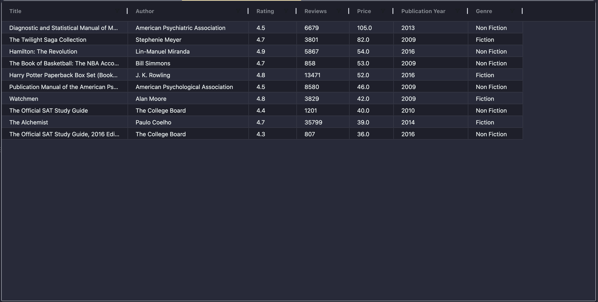
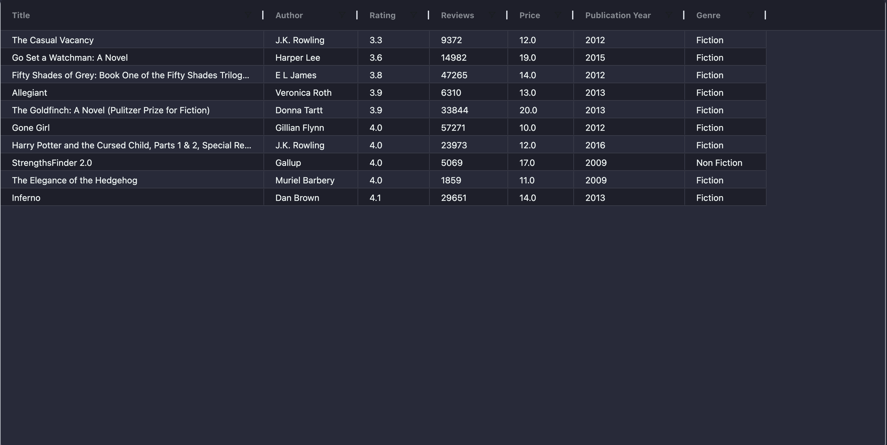

# BestSellingBooks README

## What the Project Does
This Python project analyzes a dataset of best-selling books from Amazon. It processes the data to extract valuable insights and generates various reports and summaries. The primary purpose of this project is to provide users with an understanding of the most popular books in different genres, their price ranges, ratings, and review counts.

## Main Features
1. **Data Cleaning**: The project starts by loading the dataset, removing duplicates, and renaming columns for better readability.
2. **Data Analysis**: It calculates summary statistics for each column, including:
   - The number of unique authors
   - The average rating for each genre
3. **Top Authors**: The top 10 authors are identified and exported to a CSV file.
4. **Genre Average Ratings**: The average rating of books per genre is calculated and exported to a CSV file.
5. **Book Categories**: The project categorizes books into different groups based on their price range and rating.
6. **Top Books by Rating and Reviews**: The 10 most expensive, cheapest, highest-rated, most reviewed, and least reviewed books are identified and exported to CSV files.




## Purpose of Important Files
- **BestSellingBooks.py**: This file contains the main script that performs all the data analysis and generates the reports.
- **bestsellers.csv**: The dataset used for analysis, which contains information about best-selling books including title, author, publication year, user rating, and price.

## Dependencies and Installation
- **Python**: Ensure you have Python installed on your system (version 3.x recommended).
- **Pandas**: Install Pandas by running `pip install pandas` in your terminal or command prompt.

## How to Run the Project
1. **Clone the Repository**: Clone the repository to your local machine.
2. **Navigate to the Project Directory**: Open your terminal or command prompt and navigate to the directory containing the `BestSellingBooks.py` file.
3. **Run the Script**: Execute the script by running the following command in your terminal or command prompt:
   ```bash
   python BestSellingBooks.py
   ```

## Inputs, Outputs, and Generated Files
- **Inputs**: The dataset `bestsellers.csv`.
- **Outputs**: Various CSV files containing summary statistics, top authors, average ratings by genre, and categorized books.
- **Generated Files**:
  - `top_authors.csv`: Top 10 authors by number of books sold.
  - `avg_rating_by_genre.csv`: Average rating for each genre.
  - `cheapest_books.csv`, `most_expensive_books.csv`, `highest_rating.csv`, `lowest_rating.csv`, `most_reviewed_books.csv`, `least_reviewed_books.csv`: Top 20 books categorized by price range and rating.

## Known Limitations
- The script assumes that the dataset is properly formatted and does not include any missing or corrupted data.
- The script does not include additional features like sentiment analysis or text processing of book reviews.

This project provides a comprehensive analysis of best-selling books, making it a valuable tool for those interested in understanding the market trends and reader preferences.